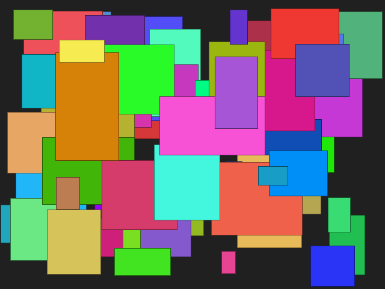
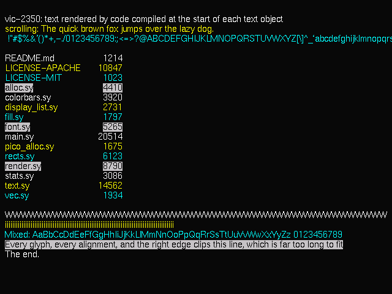
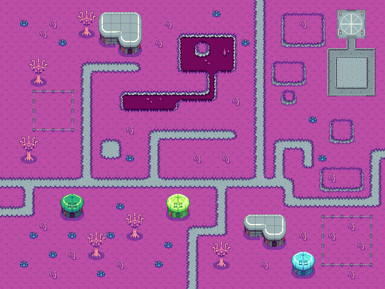

# vic-2350

This project is an envisioning of an alternate universe mid-80s home computer. It runs on RP2350 boards, with the Adafruit Fruit Jam as the primary target. The name is an homage to the [VIC-II chip] at the core of the Commodore 64 computer.

It is primarily written in [symbolasm], a modern syntax for ARM assembly language.

A roadmap is coming soon.

## Beam racing

In the early 80s, there were two camps regarding video output: a dumb framebuffer and more sophisticated on-the-fly video processing. Rendering tiles and sprites on the fly was ideally suited to 8 bit video games, enabling smoothly interactive graphics without much effort by the CPU.

Text modes were in some ways a special case of on the fly rendering. Invariably limited to fixed-width cells, video RAM contained character indices and additional attributes, and during a scanline the video hardware would look up the character index in a font RAM before scanning out. This mechanism actually has a lot in common with video game tile rendering, and C64 games often abused the text rendering capabilities to draw game content.

The heart of vic-2350 is a beam racing renderer, inspired by 80s hardware. The RP2350 has a rare confluence of factors that make beam racing appealing: framebuffers take too much RAM (so the resolution and color depth is limited), plus the chip has enough horsepower to render quite interesting graphics on the fly.

This project is a continuation of [pico-dvi-rs], with a much greater emphasis on bare metal programming.

## Building

The build needs:

- Rust, with the `thumbv8m.main-none-eabihf` target
- [symbolasm], checked out next to this repo as `../symbolasm`
- The `arm-none-eabi` binutils (only `as` and `ld` are used)
- Python 3

Then `./build.sh` builds each demo into `build/<demo>.elf`. Set `SYMBOLASM` to use a symbolasm checkout somewhere else.

The RP2350 register definitions come from the [rp235x-pac] crate, which the build fetches along with the other Rust dependencies. Set `SVD` to use a different `RP2350.svd`.

## Running

Put the board in BOOTSEL mode, then run, for example:

```
picotool -x build/colorbars.elf
```

You can also use `tools/run.sh`, which, in addition to picotool, prints logs sent over USB serial. It can also start from an existing running demo, using the "1200 bps touch" method.

## Demos

### colorbars


This just demonstrates a simple bringup of video out, and can also be useful for calibrating video capture.

### console

(no screenshot)

Displays raw USB reports; useful for debugging mice, keyboards, and other devices.

### image


Displays an image encoded using the [nibnib] image compression format. The image is stored in flash.

### rects & drag



The rects demo displays 64 colored rectangles bouncing around, showing off the animation capabilities of the race-the-beam renderer. There is also a drag variant that lets you drag the rectangles around with a USB mouse. That demo also shows off sprite rendering capabilities, for the mouse cursor.

### sd_video


Plays a video clip from the SD card. The screenshot above is from [Big Buck Bunny] by the Blender (licensed as [CC-BY 3.0]). Copy the encoded video to VIDEO.NIB in the root of the SD card.

Coming soon: a link to the encoded version, and link to the encoding tool.

### textdemo



A demo of text rendering. It's a proportionally spaced font (helvR10.bdf from adobe-100dpi from the xorg distribution). One line scrolls, showing basic animation.

### tiles



A demo of 16x16 tile rendering, 16 colors each, with multiple palettes. The tileset is by Dandelion Pixel Art; see the maps/ subdirectory for more info.

## License

Licensed under either of

- Apache License, Version 2.0
  ([LICENSE-APACHE](LICENSE-APACHE) or <http://www.apache.org/licenses/LICENSE-2.0>)
- MIT license
  ([LICENSE-MIT](LICENSE-MIT) or <http://opensource.org/licenses/MIT>)

at your option.

[symbolasm]: https://github.com/raphlinus/symbolasm
[VIC-II chip]: https://en.wikipedia.org/wiki/MOS_Technology_VIC-II
[pico-dvi-rs]: https://github.com/DusterTheFirst/pico-dvi-rs
[rp235x-pac]: https://crates.io/crates/rp235x-pac
[picotool]: https://github.com/raspberrypi/picotool
[Big Buck Bunny]: https://peach.blender.org/about/
[CC-BY 3.0]: https://creativecommons.org/licenses/by/3.0/
[nibnib]: https://github.com/raphlinus/nibnib
